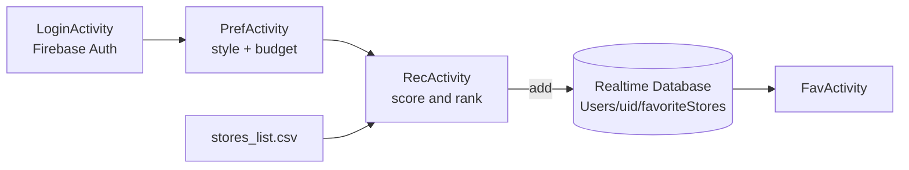

# StyleFinder

An Android app that ranks fashion shops by how well they match your style and budget, and saves your favorites to your account.

## The problem

Finding a clothing shop that fits both your taste and your wallet means walking into a lot of shops that fit neither. Map apps know where shops are, not what they sell or what it costs.

## What I built

A Java app with Firebase sign-in and a small curated catalogue of 10 Tel Aviv shops.

- Sign up or log in with email and password
- Pick a style (Vintage, Modern, Festival, Goth, Street, Formal) and a price level ($ to $$$)
- Get every shop ranked by match, each with its style, price, address and photos
- Add shops to favorites, stored per user in the cloud

## Architecture

## Design decisions

- Ranking, not filtering. A shop gets 2 points for a style match, 2 for an exact price match and 1 if the price is one level off. Every shop is shown, best first, so a narrow preference never gives an empty screen.
- The catalogue ships inside the app as a CSV asset. With 10 shops there is nothing to gain from a server round trip, and the ranking itself needs no network.
- Only favorites live in Firebase, under the user's ID, because they are the one thing that has to follow the user across devices.
- Shop cards are built in code from the catalogue rows, and photos are looked up by name at runtime, so adding a shop is a CSV row and some images, with no layout changes.

## Building

Android Gradle Plugin 7.0.3, Gradle 7.0.2, target SDK 31. Open it in Android Studio and accept the upgrade assistant, or build with JDK 11.

It needs your own Firebase project: enable Email/Password sign-in and the Realtime Database, replace `app/google-services.json`, and change the database URL hardcoded in `RecActivity` and `FavActivity`.

## Limits

The catalogue is fixed and there is no location search yet, so "near you" currently means Tel Aviv.
